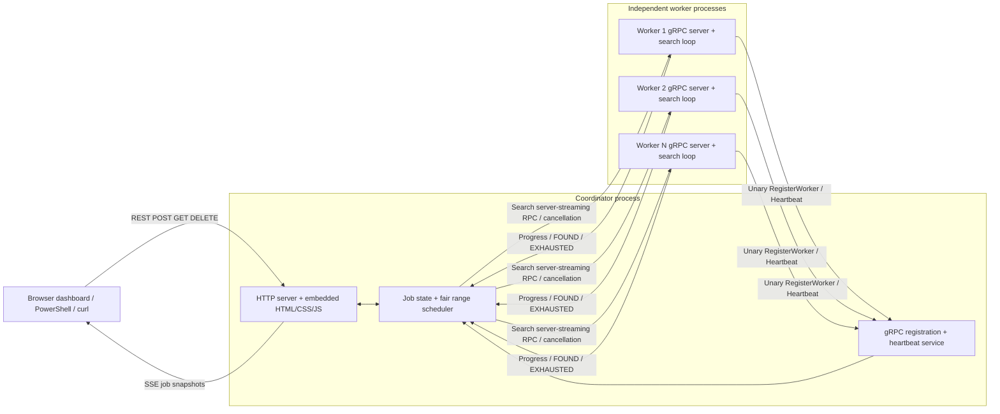
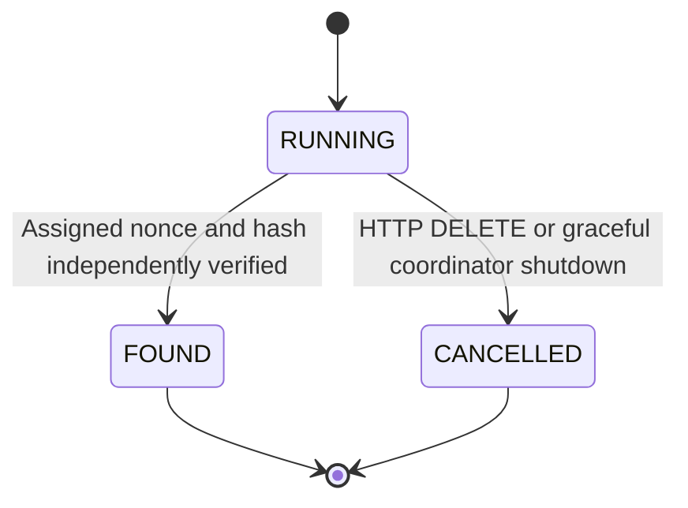

# Architecture

## Components and protocol

The coordinator owns jobs, worker sessions, assignment IDs, retry queues,
progress and SSE subscriptions. Workers listen before registering. Each has a
stable process-instance ID and a separately issued coordinator session token.
The same Go worker binary runs as multiple independent OS processes.

`proto/pow.proto` is the source of truth for generated Go bindings:

| RPC | Direction | Meaning |
|---|---|---|
| `RegisterWorker` | worker → coordinator, unary | ID, address, process instance → session token |
| `Heartbeat` | worker → coordinator, unary | ID/session refreshes its lease |
| `Search` | coordinator → worker, server streaming | Job/data/difficulty, assignment ID, `[start,end)` → cumulative progress, found proof, or explicit exhaustion |

All search updates echo their assignment ID. `checked` is cumulative within
that assignment. A final FOUND includes nonce/hash; EXHAUSTED must report the
entire range length. Plain EOF, bad proof, RPC error or timeout never completes
a range. The coordinator checks ID, bounds, monotonic counts, difficulty,
SHA-256 and exact hash before accepting a result.

| REST route | Result |
|---|---|
| `POST /jobs` | Validate one JSON object; asynchronously submit, 202 |
| `GET /jobs/{id}` | Snapshot, 404 unknown |
| `GET /jobs/{id}/events` | SSE snapshot stream; final event then close |
| `DELETE /jobs/{id}` | Cancel, 404 unknown / 409 terminal |
| `GET /jobs`, `GET /workers` | Concurrent-safe arrays |
| `GET /`, `GET /assets/{name}` | Embedded dashboard/assets |

## Range scheduling

Each job starts RUNNING with `next=0` and an empty retry queue. One coordinator
loop wakes on a buffered notification or a maintenance tick (at most 100ms).
For each alive, idle worker, it selects the next runnable job in round-robin
order. Job fairness is at chunk boundaries; a long range is not preempted for
a newer job. Multiple workers can process multiple jobs simultaneously.

It takes a queued failed range first, otherwise reserves
`[next, next + min(chunk, MaxUint64-next))` and advances `next` atomically.
This avoids overflow and normal-operation overlaps. A unique assignment ID
and cancellable, bounded RPC context accompany every range. One active
assignment is stored per worker. Network I/O runs outside the state mutex.

Explicit EXHAUSTED releases the worker for another range. Failed work retries
the **entire** range, including any already reported prefix, ensuring no gaps.
Duplicate attempts during failure/recovery are acceptable. Late messages from
an abandoned assignment are ignored. When there are no available workers the
scheduler waits, without spinning or falsely completing the job.

The final exclusive endpoint is MaxUint64; the finite search domain is
`[0, MaxUint64)`. No arithmetic wraps. If that entire domain were exhausted,
the job would stay RUNNING waiting for explicit cancellation, never FOUND.

## Worker lifecycle and failure handling

1. Bind its gRPC port and start its Search service.
2. Generate a process-instance ID and register to receive a session token.
3. Send heartbeats on a configurable interval using bounded unary RPCs.
4. Accept one active Search, enforced by an atomic busy flag.
5. Calculate SHA-256 of UTF-8 data bytes plus unsigned decimal nonce bytes.
   Check context at least every 256 candidates; report timed progress after
   sampling the clock every 1024 candidates. Send an initial zero snapshot.
6. Return FOUND or EXHAUSTED, or stop on cancellation/send failure.
7. If heartbeat fails, retry registration. Go gRPC reconnects transport;
   a restarted coordinator can accept the still-running worker again.

An alive duplicate worker ID with a different instance/address is rejected.
An identical registration is idempotent, so a lost response can be retried.
After expiry or Search failure, a new registration gets a new session.
Old heartbeats cannot refresh or revive a replacement session. Every active
result also checks worker-object identity and assignment identity, preventing
an old process from corrupting scheduling state after replacement.

Maintenance marks workers dead after the heartbeat timeout. A failed Search
can mark them dead sooner. Both cancel the assignment, queue its whole range
and log the reassignment boundaries. Healthy workers take retry work. A worker
that experiences a transient Search error can re-register via its heartbeat
loop; dead status is therefore accurate for that failed session and may later
recover. Cooperative workers stop promptly; a remote process isolated by a
network partition may briefly compute duplicate work, but its stale results
cannot be committed.

## Early termination and cancellation

The mutex serializes the only permitted state transitions:

A valid proof records a nonce pointer (so zero is representable), full hash,
reported attempt count and monotonic elapsed duration. The coordinator freezes
the terminal snapshot, cancels all other active RPCs for that job and stops
scheduling it. Simultaneous or late results see terminal state and are ignored.

DELETE follows HTTP handler → locked CANCELLED transition → Search context
cancellation → gRPC stream cancellation → worker context checks. Both sides
log cancellation. Assignment timeout, worker expiry and shutdown use the same
context mechanism. Cancelling one job leaves other jobs running. Terminal
assignments keep their worker occupied until their RPC goroutine returns,
limiting overlap during cancellation. Client completion can still precede
remote handler cleanup: a `ResourceExhausted` busy response requeues the full
range and delays that worker for 100ms without invalidating its healthy lease.
The maintenance tick retries after cooldown, avoiding a busy retry loop.

## Progress, time and SSE

Attempt counts add only positive deltas from validated cumulative worker
reports. Retries count again. A worker crash loses unreported attempts; an
exact global physical hash count is impossible without acknowledging every
hash. Counts saturate instead of overflowing, and freeze at terminal state.
Elapsed time uses Go's monotonic clock from submission through termination,
including queued time. No lowest-nonce or deterministic duration guarantee.

Each subscriber receives the current snapshot immediately, followed by
nonblocking broadcasts through a one-element latest-value channel. A full
buffer is replaced by the newer snapshot. Terminal publication cannot be
overwritten by subsequent progress because terminal jobs reject updates.
The HTTP loop also samples once a second, sends named SSE events, flushes and
sets a bounded write deadline. Disconnects remove the subscriber. Completed
jobs remain available for late subscriptions. There is no durable event replay.

## Dashboard

HTML/CSS/vanilla JS are embedded using Go `embed`, so a built coordinator needs
no static directory beside it. POST submits work, native EventSource follows
the selected job, and DELETE cancels it. Worker/history arrays refresh every
two seconds. Polling also recovers selected-job state during SSE interruptions.
EventSource retries automatically; terminal jobs close it explicitly.

Selection versions ignore responses for an older selection. Terminal state
does not regress if REST and SSE responses arrive out of order. Inputs render
with `textContent`; uint64 JSON integers are preserved as decimal strings when
they exceed JavaScript's exact-number range. No progress percentages or
interpolated counter values are fabricated. Semantic controls, status labels,
visible focus and reduced motion support keyboard/mobile use.

## Concurrency and cleanup

A single mutex protects coordinator maps, job fields, worker sessions,
assignments and subscription membership. Snapshots copy state before HTTP
encoding. Per-assignment network goroutines have bounded contexts and close
their connections. A wait group tracks maintenance and active Search calls;
shutdown first prevents new assignments, then cancels and waits. Worker search
does not share mutable candidate state. The heartbeat loop is independent of
Search, so CPU work does not depend on an incoming HTTP request staying open.

No persistence, authentication, external queue, TLS or coordinator recovery is
required for this local educational system. The race suite exercises real TCP
services; separate process tests additionally exercise launchers, forced worker
termination, logs and independent PowerShell hash verification.
